# ambientCG: Painted Wood materials

**17 assets from [ambientCG](https://ambientcg.com), dedicated to the public domain under [CC0](https://docs.ambientcg.com/license/).** Use them in any game, free or paid, and change them however you like; no credit is needed.

PBR materials as 1K and 2K JPG maps (colour, normal GL and DX, roughness, AO, displacement), one folder per resolution. 603.3 MB in all.

This is a copy kept by [zuujis-cc0](https://github.com/zuujis-cc0) so game makers can take single files from GitHub. It is not made by or affiliated with ambientCG: the originals, often in more formats and higher resolutions, are on [ambientcg.com](https://ambientcg.com). If they help you, consider [supporting ambientCG](https://www.patreon.com/ambientCG).

Every file is listed in [MANIFEST.tsv](MANIFEST.tsv) with its size and SHA-256. More free assets: [the Zuujis collection](https://github.com/zuujis-cc0/free-game-assets#readme).

| | | | |
| :-: | :-: | :-: | :-: |
| <a href="PaintedWood001">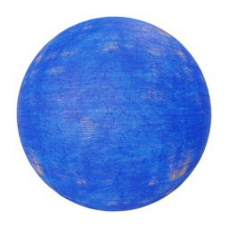</a> <b><a href="PaintedWood001">Painted Wood 001</a></b> by ambientCG · <a href="https://ambientcg.com/a/PaintedWood001">source</a> | <a href="PaintedWood002">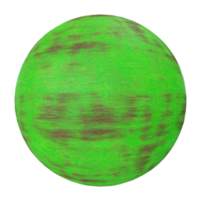</a> <b><a href="PaintedWood002">Painted Wood 002</a></b> by ambientCG · <a href="https://ambientcg.com/a/PaintedWood002">source</a> | <a href="PaintedWood003">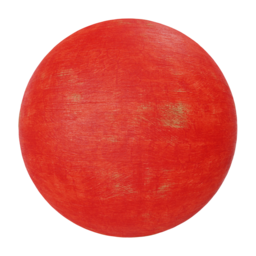</a> <b><a href="PaintedWood003">Painted Wood 003</a></b> by ambientCG · <a href="https://ambientcg.com/a/PaintedWood003">source</a> | <a href="PaintedWood004">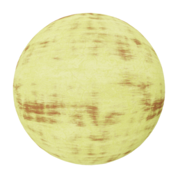</a> <b><a href="PaintedWood004">Painted Wood 004</a></b> by ambientCG · <a href="https://ambientcg.com/a/PaintedWood004">source</a> |
| <a href="PaintedWood005">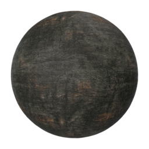</a> <b><a href="PaintedWood005">Painted Wood 005</a></b> by ambientCG · <a href="https://ambientcg.com/a/PaintedWood005">source</a> | <a href="PaintedWood006A">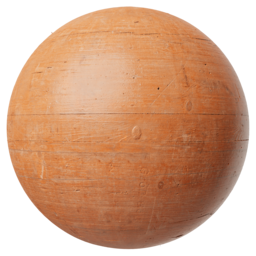</a> <b><a href="PaintedWood006A">Painted Wood 006 A</a></b> by ambientCG · <a href="https://ambientcg.com/a/PaintedWood006A">source</a> | <a href="PaintedWood006B">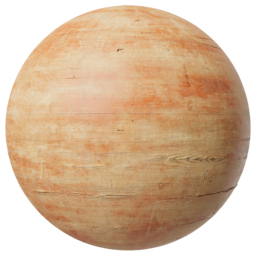</a> <b><a href="PaintedWood006B">Painted Wood 006 B</a></b> by ambientCG · <a href="https://ambientcg.com/a/PaintedWood006B">source</a> | <a href="PaintedWood006C">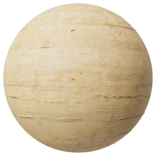</a> <b><a href="PaintedWood006C">Painted Wood 006 C</a></b> by ambientCG · <a href="https://ambientcg.com/a/PaintedWood006C">source</a> |
| <a href="PaintedWood007A">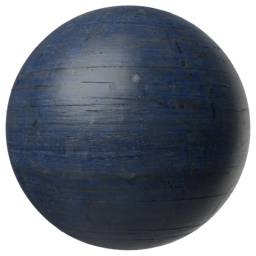</a> <b><a href="PaintedWood007A">Painted Wood 007 A</a></b> by ambientCG · <a href="https://ambientcg.com/a/PaintedWood007A">source</a> | <a href="PaintedWood007B">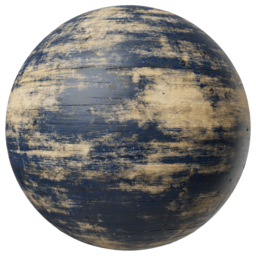</a> <b><a href="PaintedWood007B">Painted Wood 007 B</a></b> by ambientCG · <a href="https://ambientcg.com/a/PaintedWood007B">source</a> | <a href="PaintedWood007C">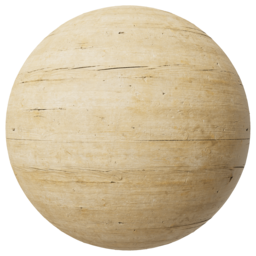</a> <b><a href="PaintedWood007C">Painted Wood 007 C</a></b> by ambientCG · <a href="https://ambientcg.com/a/PaintedWood007C">source</a> | <a href="PaintedWood008A">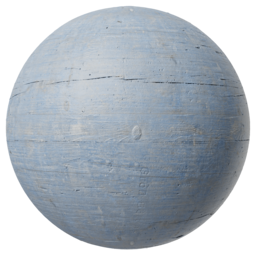</a> <b><a href="PaintedWood008A">Painted Wood 008 A</a></b> by ambientCG · <a href="https://ambientcg.com/a/PaintedWood008A">source</a> |
| <a href="PaintedWood008B">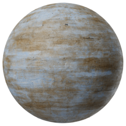</a> <b><a href="PaintedWood008B">Painted Wood 008 B</a></b> by ambientCG · <a href="https://ambientcg.com/a/PaintedWood008B">source</a> | <a href="PaintedWood008C">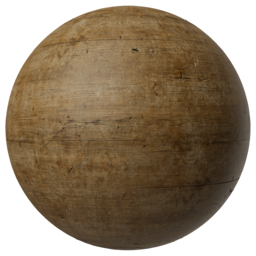</a> <b><a href="PaintedWood008C">Painted Wood 008 C</a></b> by ambientCG · <a href="https://ambientcg.com/a/PaintedWood008C">source</a> | <a href="PaintedWood009A">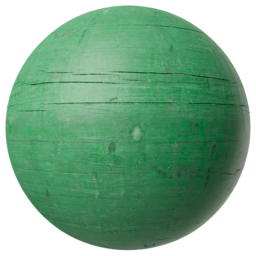</a> <b><a href="PaintedWood009A">Painted Wood 009 A</a></b> by ambientCG · <a href="https://ambientcg.com/a/PaintedWood009A">source</a> | <a href="PaintedWood009B">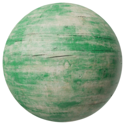</a> <b><a href="PaintedWood009B">Painted Wood 009 B</a></b> by ambientCG · <a href="https://ambientcg.com/a/PaintedWood009B">source</a> |
| <a href="PaintedWood009C">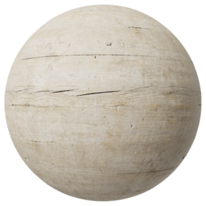</a> <b><a href="PaintedWood009C">Painted Wood 009 C</a></b> by ambientCG · <a href="https://ambientcg.com/a/PaintedWood009C">source</a> |  |  |  |

---

Kept up to date by this repository's own [update workflow](.github/workflows/update.yml), with code and plan from [cc0-mirror](https://github.com/zuujis-cc0/cc0-mirror). Something wrong? [Open an issue there](https://github.com/zuujis-cc0/cc0-mirror/issues/new) or use the [private report form](https://games.zuujis.com/report).
